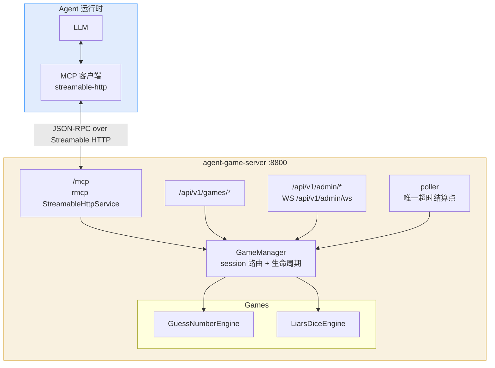

# agent-game

AI Agent 游戏框架（Rust 实现）— 新增游戏只需注册一个 `GameMeta`，MCP 工具、REST 路由、Admin 页面全部自动生效。

## 架构



五个 crate，职责单一，依赖方向单向：

| crate | 职责 | 依赖 |
|---|---|---|
| `agent-game-server-infra` | 预算、配置、错误、身份、等待原语、提示词、参数解析 | 无网络、无 axum |
| `agent-game-server-domain` | 引擎协议、大厅匹配、会话生命周期、注册表、监督者 | infra |
| `agent-game-server-core` | 具体规则（大话骰、猜数字） | domain + infra |
| `agent-game-server-mcp` | `rmcp::ServerHandler` 适配：工具定义 + 一次调用 | core + rmcp |
| `agent-game-server-server` | axum app：REST + Admin + WS + `/mcp` 挂载 + 轮询 | core + mcp + axum |

分层**由 crate 边界强制**，不靠源码扫描：每层都不依赖它上面那层，反向依赖会让
cargo 在循环依赖检查处直接失败。这条约束尝试过用字符串匹配守，四代都被绕过
（`super::super::`、`crate ::`、表达式里的类型路径、`use crate as root`），
因为文本匹配无法穷尽 Rust 的模块引用语法。见 `AGENTS.md` 第 16 条。

三条入口共用同一份 `AppState`（注册表、manager、配置、admin token），因此"谁是谁"的判断不会在三条路径上分叉。

**零改动加游戏：** 新引擎实现 `GameEngine` trait，注册一个 `GameMeta`（机器键 + 展示名 + 玩家模式 + 构造函数），MCP 工具面与 admin 展示名全部自动生效。

## 端点

| 端点 | 用途 |
|---|---|
| `GET /health` | `{ok, version, games, sessions}` |
| `GET /api/v1/games/tools` | 工具定义，按游戏分组，带 `display_name` 与 `player_mode` |
| `GET /api/v1/games/tools/{game_type}` | 单个游戏的工具面 |
| `POST /api/v1/games/{id}` | 创建/加入 session（`id` 此时是游戏类型） |
| `POST /api/v1/games/{id}/actions` | 执行动作；`action=state` 走阻塞等待 |
| `GET /api/v1/games/{id}` | 公开视图，**不含**秘密字段 |
| `GET /api/v1/games/{id}/players/{idx}` | 玩家视角；多人游戏需 `X-Player-Token` 头；立即返回 |
| `GET /api/v1/admin/games` | 对局列表（需 `X-Admin-Token`） |
| `GET /api/v1/admin/games/{id}` | 对局详情，**唯一**能看到秘密的出口 |
| `POST /api/v1/admin/prompts/reload` | 提示词热重载 |
| `GET /admin?token=` | 仪表盘；只在已出示正确 token 时注入 `window.ADMIN_TOKEN` |
| `WS /api/v1/admin/ws?token=` | 实时推送；浏览器不能设自定义头，token 走查询参数 |
| `POST /mcp` | MCP over Streamable HTTP |

> 路径参数统一叫 `{id}`：axum 0.8 把 `/games/{game_type}` 与 `/games/{session_id}`
> 视为同一个匹配形状，不同参数名会让其中一条注册失败。语义由 HTTP 方法区分。

旧版端点与新版的完整映射见 [`docs/legacy/migration.md`](docs/legacy/migration.md)。

## 快速开始

```bash
# 构建
cargo build --release

# 启动（默认 0.0.0.0:8800）
cargo run --release

# 自定义端口与时限
cargo run --release -- --port 9000 --block-budget 30 --turn-timeout 45
```

启动时会打印 admin token（未设置 `AGENT_GAME_ADMIN_TOKEN` 时为本次运行随机生成）：

```
🎮 agent-game starting...
   Game API:   http://localhost:8800
   Admin:      http://localhost:8800/admin?token=<TOKEN>
   Admin 查询头: X-Admin-Token: <TOKEN>
   MCP:        http://localhost:8800/mcp
```

服务端自身暴露 MCP 端点 `http://127.0.0.1:8800/mcp`（Streamable HTTP），Agent 直接连接，本地无需任何可执行产物。

### Agent MCP 配置

```yaml
- id: mcp-agent-game
  name: '@deepseek-ai/dsh-mcp-client'
  config:
    serverName: agent_game
    transport: streamable-http
    url: http://127.0.0.1:8800/mcp
    toolCallTimeoutMs: 70000
```

工具名带 `mcp__agent_game__` 前缀（`serverName: agent_game` 决定的），例如
`mcp__agent_game__liars_dice_join`、`mcp__agent_game__guess_number_guess`。

`toolCallTimeoutMs` 必须大于服务端 55 秒的等待预算。默认值 60000 会在服务端返回之前先触发传输层超时，Agent 看到的是超时错误而不是对局状态。

完整的接入说明（MCP 与 REST 两种方式、身份与会话的区别、`timeout` 语义、
常见误解）见 **[docs/client.md](docs/client.md)**。

`state` 工具接受可选参数 `timeout`（秒，缺省 55，上限 55）：传 `0` 表示本次不等待、立即返回；省略或传 `null` 表示用满等待预算。解析在 `core::budget::resolve_budget()` 里，MCP 与 REST 两条传输共用同一份实现。

### 环境变量

| 变量 | 说明 |
|---|---|
| `AGENT_GAME_ADMIN_TOKEN` | Admin 鉴权令牌。未设置时在启动时随机生成，并由启动横幅打印出来 |
| `AGENT_GAME_PROMPT_DIR` | 提示词目录（可选）。设置后覆盖内置模板，`prompts/reload` 重新读盘 |
| `RUST_LOG` | 日志级别，默认 `agent_game=info,warn` |

## 引擎协议

```rust
pub trait GameEngine: std::fmt::Debug + Send {
    fn game_type(&self) -> &'static str;              // 机器键：URL、工具名前缀、匹配键
    fn player_mode(&self) -> PlayerMode;              // Single | Multi
    fn finished_states(&self) -> &'static [&'static str];  // 有默认值
    fn sensitive_keys(&self) -> &'static [&'static str];   // 仅供测试当期望清单
    fn phase(&self) -> &'static str;
    fn admin_view(&self) -> Value;                    // 含秘密
    fn public_view(&self) -> Value;                   // 由构造保证不含秘密
    fn player_view(&self, idx: Option<usize>) -> Result<PlayerView, EngineError>;
    fn handle_action(&mut self, action: &str, params: ActionParams) -> Result<PlayerView, EngineError>;
    fn check_timeout(&mut self, now: Instant) -> Result<Option<TimeoutEvent>, EngineError>;
    fn signal(&self) -> Arc<ChangeSignal>;            // 等待原语
    fn is_ready_for(&self, idx: usize) -> bool;       // 有默认值：单人游戏永不等待
    fn prompts(&self) -> &PromptStore;
    // …还有 find_player_by_token / player_tokens / setup_params
}
```

三个设计要点，每一条都对应旧实现踩过的坑：

1. **`admin_view` 与 `public_view` 分别构造。** 不做"返回全量 JSON 再按名字删键"——
   那样 `secret_keys` 拼错一个字母就会静默泄密。改成构造之后，写漏一个字段的后果
   是"测试红"。
2. **全同步，等待在框架里。** 引擎只回答"现在轮到他了吗"（`is_ready_for`）与
   "变了就叫我"（`signal`），循环在 `core::wait::wait_for`。于是 `dyn GameEngine`
   直接可用，不需要 `async-trait`。
3. **`check_timeout` 返回 `Result`。** 布尔返回值无法区分"没事"与"我坏了"，
   manager 逐 session 隔离错误，一个坏引擎不影响其余对局。

## 测试与验收

```bash
cargo fmt --all -- --check          # 格式
cargo clippy --all-targets -- -D warnings   # 静态检查
cargo test                          # 单元 + 集成
cargo llvm-cov --workspace --summary-only   # 覆盖率
cargo mutants -p agent-game-server-core     # 变异测试
```

四者的分工：

| 命令 | 回答的问题 |
|---|---|
| `cargo test` | 代码有没有坏 |
| `llvm-cov` | 哪一行没被执行过 |
| `clippy` | 有没有常见写法错误 |
| `mutants` | **测试有没有用** —— 往源码注入缺陷，套件会不会红 |

覆盖率做不到第四件事。它只说明"这行被跑过"，不说明"这条规则被守住"。

测试分四层：

| 层 | 位置 | 判据 |
|---|---|---|
| 规则层 | `core` 的 `#[cfg(test)]` 模块 | 给定骰子与动作序列，结果必须确定 |
| 整局层 | `crates/agent-game-core/tests/full_game.rs` | 固定种子跑到底，每手都合法 |
| 契约层 | `crates/agent-game-server/tests/http_contract.rs`、`mcp_transport.rs` | 调用方拿到什么：状态码、错误类别、秘密边界、鉴权 |
| 不变量层 | `crates/agent-game-server/tests/invariants.rs` | 必须永远成立的规则（百搭、通知、秘密、终态） |

## 当前游戏

| 游戏 | 类型 | 说明 |
|------|------|------|
| 猜数字 | 单人 | 1-100 范围内猜目标数字 |
| 大话骰 | 多人 | 吹牛/撒谎骰子，轮流叫数，1 百搭；3 人及以上时输一轮只掉一颗骰子，掉光才出局 |

## 管理后台

http://localhost:8800/admin?token=&lt;ADMIN_TOKEN&gt;

- Dashboard HTML（展示名由服务端下发，页面不硬编码任何游戏名）
- `/api/v1/admin/games` 列表、`/api/v1/admin/games/{id}` 详情
- `POST /api/v1/admin/prompts/reload` 提示词热重载
- `WS /api/v1/admin/ws` 实时推送（只推"状态变了"，不含内容）
- 全部需 `X-Admin-Token`；`/admin` 只在请求方已出示该 token 时才把它注入页面

`target` / `all_dice` 这类秘密信息只能通过 `/api/v1/admin/*` 看到，
`GET /api/v1/games/{id}` 只返回公开视图。
