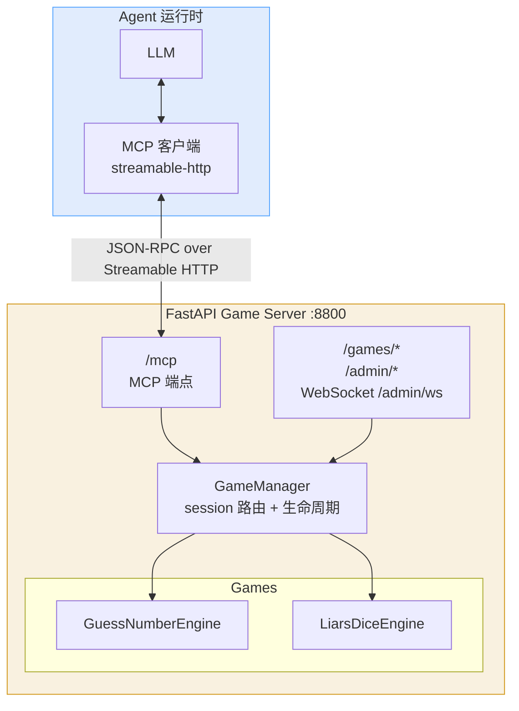

# agent-game

AI Agent 游戏框架 — 新增游戏只需写一个 Engine 文件，MCP 工具、API 路由、Admin 查询全部自动生成。

## 架构



**零改动加游戏:** 新 Engine 实现自描述协议 → `GameManager.register()` → 全部自动生效。

MCP 端点与 REST 端点跑在同一个 FastAPI app 上（`game_server.create_app()`），共享同一个 `GameManager` 与同一批引擎实例：

| 端点 | 用途 |
|---|---|
| `POST /mcp` | MCP over Streamable HTTP（`GET` / `DELETE` 也由同一个 route 处理） |
| `GET /games/tools` | MCP 工具定义（`manager.describe_all_tools()`） |
| `POST /games/{game_type}` | 创建 session |
| `POST /games/{session_id}/action` | 执行动作；`action=state` 走阻塞等待 |
| `GET /games/{session_id}` | 公开状态，已剥离 `SECRET_STATE_KEYS`（`target` / `all_dice`） |
| `GET /games/{session_id}/state/{player_index}` | 玩家视角（多人游戏需 `player_token`），立即返回不等待 |
| `/admin/*` | Dashboard、对局列表与详情、WebSocket 推送、提示词热重载 |

## 项目结构

```
agent-game/
├── main.py                            # 启动入口（uv run main.py）
├── src/
│   └── agent_game_server/             # 服务端（MCP 端点 + REST + Admin 同一个 app）
│       ├── __init__.py                # 包 re-export
│       ├── config.py                  # 共享常量（版本号、等待预算）+ timeout 解析器
│       ├── manager.py                 # GameManager（session 路由 + 超时回收）
│       ├── mcp_server.py              # MCP 协议适配层（工具定义 + 动作路由）
│       ├── game_server.py             # create_app()：MCP 端点 + Game API + Admin + WebSocket
│       ├── cli.py                     # agent-game-server CLI（在这里绑定端口 8800）
│       ├── prompt.py                  # 模板/Prompt 渲染
│       ├── templates/
│       │   └── admin.html             # 管理仪表盘
│       ├── assets/
│       │   ├── guess_number_prompts.py
│       │   └── liars_dice_prompts.py
│       └── games/
│           ├── __init__.py
│           ├── game_engine.py         # Engine 协议
│           ├── state_machine.py       # 通用状态机
│           ├── signal.py              # ChangeSignal（阻塞等待原语）
│           ├── guess_number.py        # 猜数字引擎
│           └── liars_dice.py          # 大话骰引擎
├── tests/
│   ├── test_engine.py                 # 猜数字引擎
│   ├── test_liars_dice.py             # 大话骰引擎
│   ├── test_rules.py                  # 大话骰规则：叫数合法性 / 淘汰 / 身份校验
│   ├── test_manager.py                # GameManager 路由与生命周期
│   ├── test_matching.py               # 多人匹配与配置兼容
│   ├── test_game_server.py            # REST 端点
│   ├── test_mcp_server.py             # MCP over HTTP（ASGI 内存传输，不监听 socket）
│   ├── test_wait.py                   # ChangeSignal 与阻塞式等待
│   ├── test_prompts.py                # 提示词模板：时间数值由调用方传入，不写死秒数
│   └── test_poller.py                 # 超时轮询与 admin 广播
├── docs/
│   └── issues/                        # 设计与实施记录（001 阻塞等待、002 MCP 迁移）
├── pyproject.toml
├── uv.lock
├── AGENTS.md                          # 改动本仓库时的硬约束
└── README.md
```

## 引擎自描述协议

新增游戏只需实现以下接口（duck typing，不强制基类）：

| 属性/方法 | 说明 |
|-----------|------|
| `game_type: str` | 唯一标识，如 `"my_game"` |
| `game_name: str` | 人类可读名称 |
| `player_mode: str` | `"single"` 或 `"multi"` |
| `describe_tools()` | 类方法，返回 MCP Tool 列表 `[{name, description, input_schema}]`；工具名以 `<game_type>_` 开头 |
| `handle_action(action, **params)` | 执行动作，返回 `{prompt, ...}` |
| `get_public_state()` | Admin 可见的公开状态 |
| `get_player_state(player_index)` | 玩家视角状态 + prompt 文本 |
| `check_timeout(now)` | 超时检查 |
| `wait_for_change(player_index, timeout)` | 可选，`async`。回合制游戏实现它，让非当前回合的 `state` 调用在服务端挂起 |
| `_find_player_by_token(token)` | 可选。多人引擎实现它，`player_token` 身份复用依赖这个方法 |

## 快速开始

```bash
# 安装依赖
uv sync

# 启动服务端（MCP 端点 + Game API + Admin，端口 8800）
uv run main.py

# 或安装为全局命令
uv tool install .
agent-game-server
```

服务端自身暴露 MCP 端点 `http://127.0.0.1:8800/mcp`（Streamable HTTP），Agent 直接连接，本地无需任何可执行产物。

Agent MCP 配置：
```yaml
- id: mcp-agent-game
  name: '@deepseek-ai/dsh-mcp-client'
  config:
    serverName: agent_game
    transport: streamable-http
    url: http://127.0.0.1:8800/mcp
    toolCallTimeoutMs: 70000
```

工具名带 `mcp__agent_game__` 前缀（`serverName: agent_game` 决定的），例如 `mcp__agent_game__liars_dice_join`、`mcp__agent_game__guess_number_guess`。

`toolCallTimeoutMs` 必须大于服务端 55 秒的等待预算。默认值 60000 会在服务端返回之前先触发传输层超时，Agent 看到的是超时错误而不是对局状态。

`state` 工具接受可选参数 `timeout`（秒，缺省 55，上限 55）：传 `0` 表示本次不等待、立即返回；省略或传 `null` 表示用满等待预算。解析在 `config.parse_block_budget()` 里，MCP 与 REST 两条传输共用同一份实现。

### 从旧配置迁移

本地 stdio 客户端已删除（`src/agent_game_mcp/` 整个目录不再存在），以 `command` 启动本地进程的旧配置不再可用，也不提供兼容路径。

| | 配置 |
|---|---|
| 旧（已失效） | `{"mcpServers": {"agent-game": {"command": "agent-game-mcp"}}}` |
| 新 | 上面「Agent MCP 配置」中的 streamable-http 块 |

旧配置以 `command` 启动本地进程，新配置以 `url` 直连服务端；两者传输方式不同，无法自动转换。

### 环境变量

| 变量 | 说明 |
|---|---|
| `AGENT_GAME_ADMIN_TOKEN` | Admin 鉴权令牌。未设置时在导入 `game_server` 时随机生成，并由 `cli.py` 在启动时打印出来 |

只有这一个环境变量，没有其它开关。

## 当前游戏

| 游戏 | 类型 | 说明 |
|------|------|------|
| 猜数字 | 单人 | 1-100 范围内猜目标数字 |
| 大话骰 | 多人 | 吹牛/撒谎骰子，轮流叫数，1 百搭；3 人及以上时输一轮只掉一颗骰子，掉光才出局 |

## 管理后台

http://localhost:8800/admin?token=<ADMIN_TOKEN>

- 提供 Admin Dashboard HTML
- 提供 `/admin/games` 列表接口
- 提供 `/admin/games/{session_id}` 详情接口
- 提供 `POST /admin/reload-prompts` 提示词热重载
- 提供 WebSocket `/admin/ws` 实时推送状态更新
- 需要通过 `X-Admin-Token` 头校验权限；token 在导入时解析（环境变量或随机生成），`/admin` 只在请求方已出示该 token 时才把它注入页面

`target` / `all_dice` 这类秘密信息只能通过 `/admin/*` 看到，`GET /games/{sid}` 会剥掉它们。
