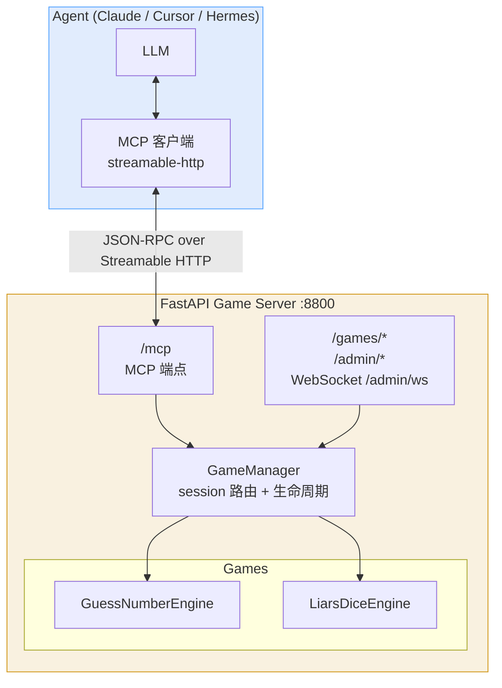

# agent-game

AI Agent 游戏框架 — 新增游戏只需写一个 Engine 文件，MCP 工具、API 路由、Admin 查询全部自动生成。

## 架构



**零改动加游戏:** 新 Engine 实现自描述协议 → `GameManager.register()` → 全部自动生效。

## 项目结构

```
agent-game/
├── main.py                            # 启动入口
├── src/
│   └── agent_game_server/             # 服务端（含 MCP 端点）
│       ├── __init__.py                # 包 re-export
│       ├── config.py                  # 共享常量（版本号、等待预算）
│       ├── manager.py                 # GameManager（session 路由）
│       ├── mcp_server.py              # MCP 协议适配层（工具定义 + 动作路由）
│       ├── game_server.py             # MCP 端点 + Game API + Admin + WebSocket (port 8800)
│       ├── cli.py                     # agent-game-server CLI
│       ├── prompt.py                  # 模板/Prompt 渲染
│       ├── templates/
│       │   └── admin.html             # 管理仪表盘
│       ├── assets/
│       │   ├── guess_number_prompts.py
│       │   └── liars_dice_prompts.py
│       └── games/
│           ├── __init__.py
│           ├── game_engine.py         # Engine 协议
│           ├── state_machine.py       # 通用状态机
│           ├── guess_number.py        # 猜数字引擎
│           └── liars_dice.py          # 大话骰引擎
├── tests/
│   ├── test_engine.py
│   ├── test_liars_dice.py
│   ├── test_manager.py
│   ├── test_mcp_server.py
│   └── test_matching.py
├── pyproject.toml
├── AGENTS.md                          # 改动本仓库时的硬约束
├── README.md
└── pytest/
```

## 引擎自描述协议

新增游戏只需实现以下接口（duck typing，不强制基类）：

| 属性/方法 | 说明 |
|-----------|------|
| `game_type: str` | 唯一标识，如 `"my_game"` |
| `game_name: str` | 人类可读名称 |
| `player_mode: str` | `"single"` 或 `"multi"` |
| `describe_tools()` | 返回 MCP Tool 列表 `[{name, description, input_schema}]` |
| `handle_action(action, **params)` | 执行动作，返回 `{prompt, ...}` |
| `get_public_state()` | Admin 可见的公开状态 |
| `get_player_state(player_index)` | 玩家视角状态 + prompt 文本 |
| `check_timeout(now)` | 超时检查 |

## 快速开始

```bash
# 安装依赖
uv sync

# 启动服务端（MCP 端点 + Game API + Admin，端口 8800）
uv run main.py

# 或安装为全局命令
uv tool install .
agent-game-server
```

服务端自身暴露 MCP 端点 `http://127.0.0.1:8800/mcp`（Streamable HTTP），Agent 直接连接，本地无需任何可执行产物。

Agent MCP 配置：
```yaml
- id: mcp-agent-game
  name: '@deepseek-ai/dsh-mcp-client'
  config:
    serverName: agent_game
    transport: streamable-http
    url: http://127.0.0.1:8800/mcp
    toolCallTimeoutMs: 70000
```

工具名带 `mcp__agent_game__` 前缀，例如 `mcp__agent_game__liars_dice_join`、`mcp__agent_game__guess_number_guess`。

`toolCallTimeoutMs` 必须大于服务端 55 秒的等待预算。默认值 60000 会在服务端返回之前先触发传输层超时，Agent 看到的是超时错误而不是对局状态。

### 从旧配置迁移

本地 stdio 客户端 `agent-game-mcp` 已删除，旧配置不再可用，也不提供兼容路径。

| | 配置 |
|---|---|
| 旧（已失效） | `{"mcpServers": {"agent-game": {"command": "agent-game-mcp"}}}` |
| 新 | 上面「Agent MCP 配置」中的 streamable-http 块 |

旧配置以 `command` 启动本地进程，新配置以 `url` 直连服务端；两者传输方式不同，无法自动转换。

默认环境变量：
- `AGENT_GAME_ADMIN_TOKEN`：Admin 鉴权令牌，未显式设置时会随机生成

## 当前游戏

| 游戏 | 类型 | 说明 |
|------|------|------|
| 猜数字 | 单人 | 1-100 范围内猜目标数字 |
| 大话骰 | 多人 | 吹牛/撒谎骰子，轮流叫数，1 百搭 |

## 管理后台

http://localhost:8800/admin

- 提供 Admin Dashboard HTML
- 提供 `/admin/games` 列表接口
- 提供 `/admin/games/{session_id}` 详情接口
- 提供 WebSocket `/admin/ws` 实时推送状态更新
- 需要通过 `X-Admin-Token` 头校验权限；启动时默认自动生成 token
