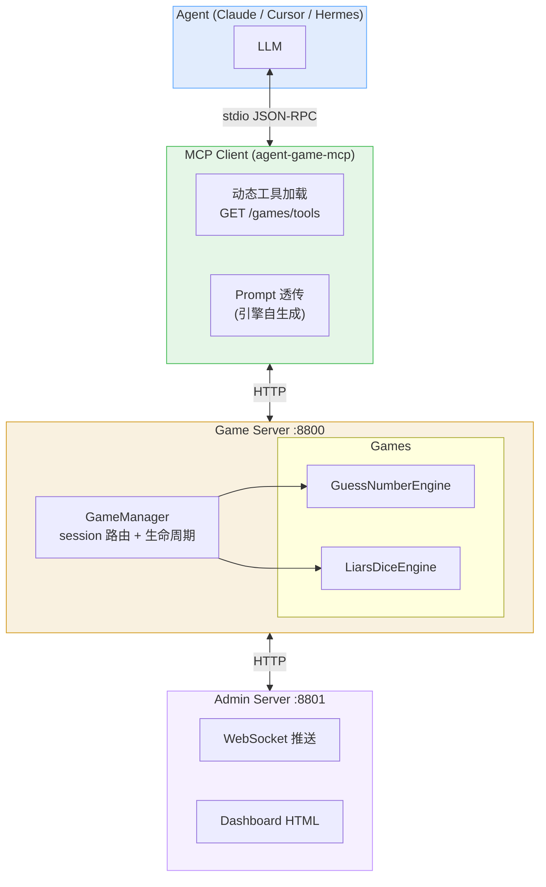

# agent-game

AI Agent 游戏框架 — 新增游戏只需写一个 Engine 文件，MCP 工具、API 路由、Admin 查询全部自动生成。

## 架构



**零改动加游戏:** 新 Engine 实现自描述协议 → `GameManager.register()` → 全部自动生效。

## 项目结构

```
agent-game/
├── main.py                            # 启动入口
├── src/
│   ├── agent_game_mcp/                # Agent 侧客户端
│   │   ├── __init__.py
│   │   └── client.py                  # 动态加载工具 + Prompt 透传
│   └── agent_game_server/             # 服务端
│       ├── __init__.py                # 包 re-export
│       ├── manager.py                 # GameManager（session 路由）
│       ├── game_server.py             # Game API (port 8800)
│       ├── admin_server.py            # Admin + WebSocket (port 8801)
│       ├── cli.py                     # agent-game-server CLI
│       ├── templates/
│       │   └── admin.html             # 管理仪表盘
│       └── games/
│           ├── guess_number.py        # 猜数字引擎
│           └── liars_dice.py          # 大话骰引擎
├── tests/
│   ├── test_engine.py
│   ├── test_liars_dice.py
│   └── test_manager.py
└── pyproject.toml
```

## 引擎自描述协议

新增游戏只需实现以下接口（duck typing，不强制基类）：

| 属性/方法 | 说明 |
|-----------|------|
| `game_type: str` | 唯一标识，如 `"my_game"` |
| `game_name: str` | 人类可读名称 |
| `player_mode: str` | `"single"` 或 `"multi"` |
| `describe_tools()` | 返回 MCP Tool 列表 `[{name, description, input_schema}]` |
| `handle_action(action, **params)` | 执行动作，返回 `{prompt, ...}` |
| `get_public_state()` | Admin 可见的公开状态 |
| `get_player_state(player_index)` | 玩家视角状态 + prompt 文本 |
| `check_timeout(now)` | 超时检查 |

## 快速开始

```bash
# 启动服务端（Game + Admin）
uv sync && uv run main.py

# 或安装为全局命令
uv tool install .
agent-game-server

# 安装 Agent 客户端
uv tool install .
```

Agent MCP 配置：
```json
{"mcpServers": {"agent-game": {"command": "agent-game-mcp"}}}
```

## 当前游戏

| 游戏 | 类型 | 说明 |
|------|------|------|
| 猜数字 | 单人 | 1-100 范围内猜目标数字 |
| 大话骰 | 多人 | 吹牛/撒谎骰子，轮流叫数，1 百搭 |

## 管理后台

http://localhost:8801/admin — WebSocket 实时推送，观测全部对局和秘密数据。
