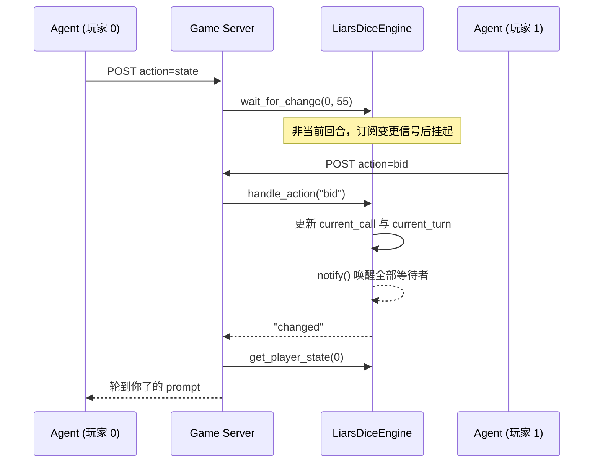

# 阻塞式对局等待

| 项 | 值 |
|---|---|
| 本地编号 | 001 |
| GitHub Issue | [#1](https://github.com/Hypnoes/agent-game/issues/1) |
| 分支 | `issue-1-blocking-state` |
| 状态 | 已合并 |

## 背景

**Engine 自描述协议。** 每个游戏引擎实现 `describe_tools()`、`handle_action(action, **params)`、`get_player_state(player_index)` 等方法。`GameManager` 通过 duck typing 调用它们，不强制基类。新增游戏只需写一个引擎文件。

**MCP 与 Agent 侧会话。** MCP（Model Context Protocol）是 Agent 调用外部工具的协议。`src/agent_game_mcp/client.py` 是一个本地 stdio MCP 服务器，向 Agent 暴露从 `GET /games/tools` 拉取的工具。它维护 `_SESSIONS[game_type]`，自动为 Agent 分配和复用 `session_id`，使 Agent 不必手动传。该文件在后续改动中将被移除，本次改动仍保留它。

**大话骰的回合制。** 两名玩家轮流叫数（`bid`）或开盅（`challenge`）。`current_turn` 记录轮到谁。非当前回合的玩家若调用 `state`，引擎只返回"等待某某行动"的提示文本，立即结束。

## 当前的问题

引擎和 HTTP 接口都是同步的：`handle_action` 直接返回，`POST /games/{session_id}/action` 不做任何等待。而工具描述和提示词模板却宣称 `state` 调用会阻塞最长 60 秒。实测非自己回合调用 `state`，服务端 3 毫秒返回。

Agent 读到"会阻塞、返回慢是正常的"这一描述，却立刻拿到"还没轮到你"的回复，于是立刻再次调用，形成没有退避的紧循环轮询。一个回合内可能消耗几十次工具调用。`client.py` 中为 `state` 设置的 60 秒超时也因此永远不会触发。

单纯依靠提示词要求模型自行等待并不可靠：模型没有可靠的计时能力，也无法感知对手是否已行动。

## 目标

让 `state` 调用在尚未轮到调用者时挂起，直到对手行动、对局结束或等待预算耗尽，然后返回当时的状态。挂起由服务端实现，Agent 只发起一次调用。

等待预算固定为 55 秒。它低于 `client.py` 的 60 秒超时，也低于 MCP 消费端默认的 60 秒工具调用超时，因此超时总是由游戏服务端先发生，Agent 收到的是正常的状态文本而非传输层错误。

挂起用 `asyncio` 的事件等待实现，不占用线程。一个请求在等待期间，同一事件循环上的其他请求照常处理。

## 设计

### 整体流程



### 变更信号原语

新增 `src/agent_game_server/games/signal.py`，提供 `ChangeSignal`：

| 成员 | 行为 |
|---|---|
| `subscribe()` | 新建并登记一个 `asyncio.Event`，返回它 |
| `unsubscribe(ev)` | 移除登记 |
| `notify()` | 取出并清空全部等待者，逐个 `set()` |
| `wait(timeout)` | 等待信号，返回 `"changed"` 或 `"timeout"`；被取消时重新抛出 `CancelledError` |

`subscribe()` 每次新建 `asyncio.Event` 而不是复用同一个。`Event` 在首次等待时绑定当时的事件循环，跨循环复用会静默失效。

`notify()` 先整体换出等待者列表再逐个唤醒，避免在遍历过程中收到新的 `subscribe()` 导致漏唤醒。

`wait()` 内部用 `asyncio.wait_for`，把 `TimeoutError` 映射为 `"timeout"`。取消不吞掉，交由调用方处理。

### 引擎接入

`games/liars_dice.py` 的改动：

- `__init__` 中创建 `self._signal = ChangeSignal()`；把 `check_timeout` 与 `_build_prompt` 中硬编码的 60 秒提取为 `self.turn_timeout = 60`。
- 在状态发生变化的路径上调用 `notify()`：`_add_player`、`_start_game`、`_make_bid`、`_challenge`，以及 `check_timeout` 的两个超时分支。
- 新增异步方法 `wait_for_change(player_index, timeout)`。

`turn_timeout` 与等待预算 `BLOCK_BUDGET` 是两个不同的数值。前者决定多久未行动判负（60 秒），后者决定单次调用最多挂起多久（55 秒）。超时判负同样走 `notify()`，因此一次等待有三种结束方式：被对手行动唤醒、被超时判负唤醒、或在 55 秒后自行返回。

等待方法的执行顺序是"先订阅、再检查、再等待"：

```python
async def wait_for_change(self, player_index: int, timeout: float) -> str:
    ev = self._signal.subscribe()
    try:
        if self.phase == "finished":
            return "ready"
        if self.phase != "waiting" and self.current_turn == player_index:
            return "ready"
        return await self._signal.wait(timeout)
    finally:
        self._signal.unsubscribe(ev)
```

顺序反过来会出现丢失唤醒：若在检查与订阅之间对手完成行动，`notify()` 找不到等待者，随后的等待将一直持续到超时。先订阅再检查，最坏情况是立即被唤醒并多走一次检查。

`phase == "waiting"` 时同样挂起等待，覆盖大厅匹配阶段。匹配的 120 秒超时仍由 `check_timeouts` 独立结算。

### 协议扩展

`games/game_engine.py` 的协议增加可选方法：

```python
async def wait_for_change(self, player_index: int, timeout: float) -> str: ...
```

标注为可选。`guess_number` 是单人即时游戏，不实现该方法；服务端调用前用 `hasattr` 判断。

### 服务端接线

`game_server.py` 中 `POST /games/{session_id}/action` 已经是 `async def`，`action == "state"` 分支增加等待：

```python
BLOCK_BUDGET = 55.0

body = await request.json()
action = body.pop("action")
engine = manager.get(session_id)
if action == "state":
    pi = body.pop("player_index", 0)
    timeout = min(float(body.pop("timeout", BLOCK_BUDGET)), BLOCK_BUDGET)
    if hasattr(engine, "wait_for_change"):
        await engine.wait_for_change(pi, timeout)
    manager.check_timeouts()
    return engine.get_player_state(pi)
return engine.handle_action(action, **body)
```

`GET /games/{session_id}/state/{player_index}` 保持立即返回，不做任何等待。它是调试与管理界面的查询入口，同时也是后续 MCP 迁移阶段测试的参照点。

等待返回后立即调用一次 `check_timeouts()`，使超时导致的对局结束在同一次请求内生效，无需等待后台 0.5 秒轮询。

### 文案调整

以下描述改为与实现一致，等待预算统一为 55 秒：

| 位置 | 调整 |
|---|---|
| `liars_dice.py` 的 `liars_dice_state` 工具描述 | "最长约 60 秒" → "最长 55 秒" |
| `assets/liars_dice_prompts.py` 的 `not_your_turn` | 该模板只在等满 55 秒后渲染，改为"已等待 55 秒，对手仍未行动"；删除"再调一次继续等"的循环引导 |
| `assets/liars_dice_prompts.py` 的 `waiting` | 说明阻塞语义与真实秒数 |
| `agent_game_mcp/client.py` 的 `state` 超时 | 保持 60 秒不动，比服务端预算多留 5 秒余量；该文件在 002 中整体删除 |

`liars_dice_state` 的 `input_schema` 增加可选参数 `timeout`（秒），缺省 55，上限 55。

## 测试

新增 `tests/test_wait.py`：

| 用例 | 断言 |
|---|---|
| `test_ready_returns_immediately` | 轮到自己时不进入等待 |
| `test_wakes_on_opponent_bid` | 后台任务等待期间对手叫数，0.1 秒内返回 `"changed"` |
| `test_returns_at_wait_budget` | 传入 0.2 秒预算时约 0.2 秒返回 `"timeout"` |
| `test_no_lost_wakeup` | 先订阅、再叫数、再等待，立即返回 |
| `test_cancellation_cleans_waiters` | 取消等待任务后等待者列表为空 |
| `test_timeout_transitions_game` | `turn_timeout` 到期后 `check_timeouts()` 将当前回合玩家判负 |
| `test_multi_waiter_all_woken` | 两个等待者同时被唤醒 |

`tests/test_game_server.py` 增加两条：`state` 动作走等待路径；`GET /state/{idx}` 不进入等待。

等待相关测试通过注入短超时控制耗时，不使用真实的 55 秒等待。全部用例应在 2 秒内完成。

## 顺带修正

以下问题在本次改动的同一批文件中，一并处理：

- `POST /admin/reload-prompts` 缺少 `_check_admin_token` 校验，是当前唯一没有鉴权的写接口。
- `GET /games/{session_id}/state/{player_index}` 传入越界索引时抛 `IndexError`，返回 500。改为 404。
- `check_timeouts` 没有 `finished` 分支，已结束的对局不会被回收，`admin/games` 列表持续增长。增加保留期后回收。
- `FastAPI(version="0.2.0")` 与 `pyproject.toml` 的 0.2.2 不一致。
- `game_server.py` 中 `_ADMIN_TOKEN` 模块变量赋值后从未使用。
- `GameManager.route()` 无调用方。

## 验收标准

1. `uv run pytest` 全部通过，用例总数从 41 增至约 50。
2. 等待相关用例总耗时低于 2 秒。
3. 手工验证：两名玩家加入大话骰后，非当前回合者调用 `state`，其请求在对手 `bid` 后 1 秒内返回且 `current_turn` 已更新。
4. 手工验证：无人行动时 `state` 在 55 秒后返回，内容为等待提示而非错误。
5. 手工验证：`GET /games/{sid}/state/{idx}` 始终立即返回。

## 已知边界

**取消传播不一致。** MCP SDK 层的取消（`notifications/cancelled`）会传递到工具处理器，`CancelledError` 可被捕获。裸 HTTP socket 断开不会取消处理器，等待会持续到自身超时。等待者清理放在 `finally` 中，两种路径都不会泄漏。

**并发不受影响。** 同一会话上的一个阻塞调用不会阻塞其他调用。实测一个调用阻塞 3 秒期间，同会话另一调用 0.01 秒返回；两个并行阻塞调用并行完成而非串行。

**55 秒硬上限。** 请求中传入更大的 `timeout` 会被截断为 55。这是为了让游戏服务端总是先于传输层超时产生响应。

**判负需要第二次调用才能感知。** 55 秒预算短于 60 秒的判负时限，因此第一次等待返回时对局可能仍在进行。若对手持续不行动，第二次调用会在判负发生的那一刻被唤醒。

## 不在本次范围

- MCP over HTTP 迁移与 `client.py` 移除，见 [002](./002-mcp-http-transport.md)。
- 大厅匹配阶段的阻塞行为只做与回合等待一致的接线，不改变 120 秒匹配超时的语义。

## 实施结果

已实现并合入 `master`（`be51376`）。落地时与本规划不同的地方：

| 规划 | 实际落地 | 原因 |
|---|---|---|
| `wait_for_change` 被唤醒即返回 | 改成 `while True` 循环，每轮重新判断 `_is_my_turn_or_over`，只有剩余预算耗尽才返回 `"timeout"` | `notify()` 是全局广播。规划只考虑了两名玩家，3 人及以上时第三名玩家会被别人的叫数误唤醒；单次唤醒就返回会让 Agent 以为自己可以行动 |
| 等待条件 `phase != "waiting" and current_turn == player_index` | 提取成 `_is_my_turn_or_over()`：`phase == "finished"` 或 `phase == "bidding" and current_turn == player_index` | 规划里的条件把 `finished` 当成"轮到自己"，且没有单独表达"对局结束"这一出口 |
| 服务端 `timeout = min(float(...), BLOCK_BUDGET)` | 解析移到 `config.parse_block_budget()`，MCP 与 REST 两条传输共用 | 两处各写一遍时语义相反，见下一行 |
| 未预见两个传输的语义分叉 | REST 的 `min(float(...), BLOCK_BUDGET)` 让 `timeout=0` 就是 0，MCP 的 `float(args.pop("timeout", None) or BLOCK_BUDGET)` 让 0 变成 55 | `or` 把 0 当成缺省值。现在 `0` 统一表示"本次不等待"，`None`/省略统一表示用满预算 |
| REST 的 `state` 先等待、后由引擎校验 | 先解析入参、再用 `_state_player_error()` 校验玩家，最后才进 `wait_for_change` | 否则越界索引或错误 token 会先白等满 55 秒才报错 |
| 未涉及多人淘汰 | 引擎新增 3 人及以上的掉骰淘汰：输一轮只掉一颗骰子，掉光才出局；只剩 2 名存活玩家时仍是突然死亡 | 3 人局若沿用"输一轮即出局"，第 2 轮就只剩两人，第三人没有任何对抗空间 |

`ChangeSignal.wait()` 还多了一个 `ev` 参数，允许调用方传入自己在循环外 `subscribe()` 的事件，避免"检查与进入等待之间"发生的 `notify()` 被丢掉。`tests/test_wait.py` 与 `tests/test_mcp_server.py::test_timeout_zero_vs_absent_end_to_end` 覆盖上述行为。
