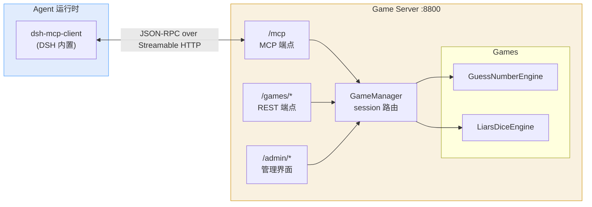

# 迁移到 MCP over HTTP 并移除本地客户端

| 项 | 值 |
|---|---|
| 本地编号 | 002 |
| GitHub Issue | 待创建后回填 |
| 前置 | [001 阻塞式对局等待](./001-blocking-state-wait.md) |
| 分支 | `issue-<编号>-mcp-http` |
| 状态 | 规划完成，未开工 |

## 背景

**MCP（Model Context Protocol）。** 一种让 Agent 调用外部工具的协议。本仓库有两种使用方式：客户端以 stdio 与 Agent 通信，服务端提供工具定义与执行。协议规定的传输方式之一是 Streamable HTTP：Agent 直接对 HTTP 端点发 JSON-RPC 请求，服务端在响应体的 SSE 帧中返回结果。

**当前架构。** `src/agent_game_mcp/client.py` 是一个本地 stdio MCP 服务器。Agent 启动它，它启动时从 `GET /games/tools` 拉取工具描述，把工具注册给 Agent；Agent 调用工具时，它把请求转成 `POST /games/{session_id}/action`。它还维护 `_SESSIONS[game_type]`，为 Agent 自动分配和复用会话。

这层本地客户端带来三个成本：需要在 Agent 侧安装可执行命令；每次调用多一跳进程间通信；会话状态存在 Agent 本地，Agent 重启即丢失。

**已确认的外部条件。** 本机的 DeepSeek Harness 已内置 `@deepseek-ai/dsh-mcp-client`（在 `app.asar` 的包清单中可查到），支持 `transport: streamable-http`、自定义 `url` 与 `headers`、`toolCallTimeoutMs`（默认 60000 毫秒）以及断线自动重连。消费端无需任何开发。

## 目标

游戏服务端自身暴露 MCP 端点，Agent 用其 MCP 客户端通过 Streamable HTTP 直接连接，本地不再有可执行产物。这与既有的工具接入偏好一致：远端服务暴露 MCP 端点，本地只消费描述，不构建本地 CLI 产物。

工具直接复用各引擎已有的 `describe_tools()`。本地客户端包被删除，会话管理逻辑上移到服务端。

## 关键技术结论

以下结论来自实测，构成本次改动的施工前提。

| 事项 | 结论 |
|---|---|
| 与现有 REST 同端口共存 | 可行。用 `Route("/mcp", endpoint=session_manager.asgi_app, methods=["GET", "POST", "DELETE"])` |
| 用 `Mount` 挂载 | 不可行。`Mount("/mcp", app)` 会返回 307 重定向到 `/mcp/`，裸 HTTP 客户端失败 |
| 自定义 endpoint 包装 | 不可行。包一层 `async def` 再 `return None` 会触发 `TypeError: 'NoneType' object is not callable` |
| 会话身份来源 | `ctx.request.headers["mcp-session-id"]`，同一连接内稳定 |
| 会话回收 | DELETE 后请求返回 404，但 `_server_instances` 条目不回收，计数持续增长。必须设置 `session_idle_timeout` |
| 协议版本 | 本机 `mcp==2.0.0`。客户端首选 `2026-07-28`，服务端协商回落至 `2025-11-25`；服务端接受 `2024-11-05` 起的握手版本 |
| 无 socket 集成测试 | 可行。`httpx2.ASGITransport` 配合手动进入 lifespan，`initialize` / `list_tools` / `call_tool` 均通过 |

## 设计

### 组件关系



REST 端点保留。它服务于管理界面、调试脚本与既有测试；MCP 端点与它共享同一个 `GameManager` 和同一批引擎实例。

### 新建 `src/agent_game_server/mcp_server.py`

模块对外提供一个构造函数：

```python
def build_mcp_server(manager: GameManager) -> Server:
```

不包含任何游戏逻辑，只做协议适配。

`on_list_tools` 直接把 `manager.describe_all_tools()` 的返回值转成 `types.Tool`。引擎现有的 `describe_tools()` 无需改动。

`on_call_tool` 把工具名解析为 `(game_type, action)` 后路由到 `manager`。原先 `client.py` 承担的会话管理职责在此实现：

| client.py 现有职责 | 迁移后位置 |
|---|---|
| `_SESSIONS[game_type]` 自动追踪 | `_MCP_SESSIONS[mcp_session_id][game_type]` |
| `start` 动作强制换新会话 | 相同逻辑，服务端执行 |
| 会话返回 404 时自动重建 | `manager.get()` 返回 `None` 时重建 |
| `join` 前查询状态，已结束则重建 | 相同逻辑 |
| `state` 使用 60 秒超时 | 转为 `timeout` 参数，与 001 的等待逻辑合并 |
| `player_token` 透传 | 作为 `manager.create()` 的参数，不变 |
| 进程内异常转成中文提示文本 | 转为 MCP 的 `isError` 结果 |

工具名到 `(game_type, action)` 的解析沿用 `client.py` 的 `_parse_tool_name` 逻辑：用已注册工具名的前缀集合匹配，避免 `guess_number` 与假设中的 `guess` 游戏互相误判。

### 身份约束

游戏归属由 `player_token` 决定，`mcp_session_id` 只作为连接级缓存键。

这条约束来自实测中的一次失败。最初的实现让每个 MCP 连接各自持有一局游戏，结果两名玩家被分进两局，双方调用 `state` 都得到"轮到你"。会话标识描述的是连接，不是玩家。

因此：请求带 `player_token` 时，先在所有活动会话中按 token 查找；找到即复用。找不到再走匹配流程。两者都没有时才创建新会话。

### 挂载方式

`game_server.py` 中创建会话管理器：

```python
session_manager = StreamableHTTPSessionManager(
    app=mcp_server,
    stateless=False,
    session_idle_timeout=600,
)
```

三个参数都有明确理由：

- `stateless=False`：需要会话状态，因为工具调用之间存在会话缓存。
- `session_idle_timeout=600`：实测 DELETE 后条目不会被移除，不设上限则长期运行持续泄漏。600 秒覆盖一局对弈的合理空档。
- `app` 传入 `build_mcp_server()` 的返回值。

生命周期在现有的 `lifespan` 中挂接：

```python
async with session_manager.run():
    yield
```

路由注册使用 `Route` 而非 `Mount`，`endpoint` 直接传 `session_manager.asgi_app`。

### 删除范围

| 文件 | 动作 |
|---|---|
| `src/agent_game_mcp/`（整个目录） | 删除 |
| `tests/test_client.py` | 删除，逻辑重写为 `tests/test_mcp_server.py` |
| `pyproject.toml` 的 `[project.scripts]` | 删除 `agent-game-mcp` 入口 |
| `pyproject.toml` 的 wheel `packages` | 移除 `src/agent_game_mcp` |
| `pyproject.toml` 的 `[tool.hermes.verify]` | `start` 与 `poll` 的端口由 8000 改为 8800，与 CLI 一致；`poll` 改为 `http://127.0.0.1:8800/mcp` |
| `README.md` | 架构图去掉客户端子图；快速开始改为配置 MCP 客户端；工具名说明加上 `mcp__agent_game__` 前缀 |

新增 `AGENTS.md`，记录三条约束：MCP 端点的挂载写法、阻塞等待的预算上限、身份由 `player_token` 决定。

### 消费端配置

写入 README：

```yaml
- id: mcp-agent-game
  name: '@deepseek-ai/dsh-mcp-client'
  config:
    serverName: agent_game
    transport: streamable-http
    url: http://127.0.0.1:8800/mcp
    toolCallTimeoutMs: 70000
```

`toolCallTimeoutMs` 必须大于 001 中确定的 55 秒等待预算。其默认值 60000 会在游戏服务端返回之前先触发传输层超时，Agent 看到的将是超时错误而非对局状态。

## 测试

新增 `tests/test_mcp_server.py`，使用无 socket 的 ASGI 传输：

| 用例 | 断言 |
|---|---|
| `test_initialize_and_list_tools` | 握手成功，7 个工具全部返回且 schema 完整 |
| `test_tool_call_routes_to_engine` | `liars_dice_join` 落到对应引擎 |
| `test_session_isolation` | 两个 mcp 会话各自缓存，互不干扰 |
| `test_player_token_identity_wins` | 同一 token 跨 mcp 会话重连回原对局 |
| `test_state_blocks_until_opponent_moves` | 端到端等待语义成立 |
| `test_finished_game_not_reused` | 对局结束后重新加入得到新会话 |
| `test_unknown_tool_returns_error` | 返回错误结果而非 500 |

其中 `test_player_token_identity_wins` 对应上文记录的真实缺陷，是本次改动的核心回归用例。

## 验收标准

1. `uv run pytest` 全部通过，`tests/test_client.py` 已移除，`tests/test_mcp_server.py` 到位。
2. `uv run agent-game-server` 启动后，`curl -X POST http://127.0.0.1:8800/mcp` 能完成 MCP 握手。
3. `GET /games/tools`、`POST /games/{sid}/action`、`/admin` 等既有端点行为不变。
4. 在 DeepSeek Harness 中配置上述 MCP 客户端后，工具以 `mcp__agent_game__liars_dice_join` 形式出现并可调用。
5. 两名 Agent 各自连接，完成一局大话骰，非当前回合者的 `state` 调用在对手行动后返回。
6. `src/agent_game_mcp/` 目录不存在，仓库中不再出现 `agent-game-mcp` 命令。

## 已知边界

**协议版本回落。** 服务端不实现 `2026-07-28` 的现代传输，实际协商结果为本机 SDK 支持的最高握手版本 `2025-11-25`。这是 SDK 行为，不影响功能。

**会话回收仍是定时清理。** `session_idle_timeout` 是空闲超时，不是即时回收。DELETE 之后条目会保留到超时或进程退出。

**不保留兼容层。** 移除 `agent_game_mcp` 后，旧的 `{"mcpServers": {"agent-game": {"command": "agent-game-mcp"}}}` 配置将失效。目标就是彻底放弃本地客户端，因此不提供兼容路径；README 给出新旧配置对照。

## 不在本次范围

- 阻塞等待本身的实现，见 [001](./001-blocking-state-wait.md)。本次改动只把已有的等待语义搬到 MCP 传输层。
- 认证。MCP 端点默认监听本机回环地址；若需对外暴露，鉴权方案另开任务。
